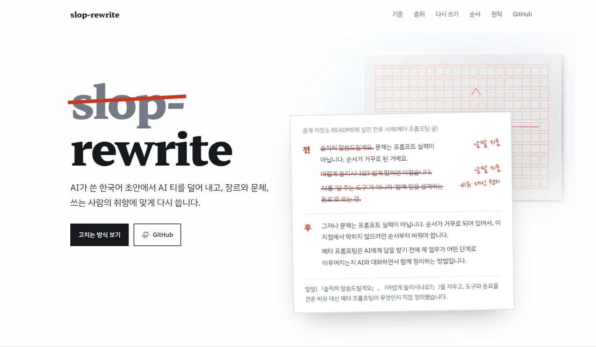

# slop-rewrite

[](https://slop-rewrite.vercel.app/)

**[공개 사이트에서 윤문 방식과 전후 사례 보기 →](https://slop-rewrite.vercel.app/)**

AI가 쓴 한국어 초안에서 AI 티를 덜어 내고, 장르와 문체, 쓰는 사람의 취향에 맞게 다시 씁니다. 업무 글과 학술 글, 줄글과 개조식 보고서를 다룹니다. Claude Code와 Codex에서 자연어로 부르는 스킬입니다.

## 어떤 점이 다른가

slop-rewrite는 사람이 읽기에 자연스럽고 핵심이 곧장 전달되는 한국어를 첫째 기준으로 삼습니다. 원칙으로 AI 티를 덜고, 문체 가이드와 개인 취향으로 쓰는 사람에게 맞춥니다.

### 검사기 통과 수치는 품질로 치지 않습니다

검사기는 셀 수 있는 규칙 위반을 찾습니다. 모두 통과해도 글이 자연스럽고 핵심이 잘 전달된다는 뜻은 아닙니다. 검사 결과는 고칠 자리를 찾고 수정 뒤에 확인하는 데 씁니다.

문장 길이나 표현 횟수를 맞추는 데 집중하면, 문장을 억지로 자르거나 같은 뜻의 다른 상투어로 바꿀 수 있습니다. 그래서 수치와 규칙만으로 글의 품질을 판정하지 않습니다. 규칙을 지키는 범위에서 문장과 문단이 자연스럽게 읽히도록 고칩니다.

### LLM이 글을 고치고, 코드는 규칙 위반을 확인합니다

AI 티 나는 낱말만 바꾸면 반복되는 문장 구조나 뻔한 설명은 남을 수 있습니다. slop-rewrite는 코드로 고칠 자리를 짚고, LLM이 문맥을 읽어 문장과 문단을 다시 씁니다. 검사기는 파일을 읽기만 하며 자동 교정 기능이 없습니다. 코드가 결과의 문장이나 쉼표를 직접 고치지 않습니다.

원칙과 문체 가이드, 개인 취향은 한 장 프롬프트로 모읍니다. LLM은 그 지시와 원문을 읽고 문단 순서, 병합과 분할, 소제목, 길이를 정합니다. 원문의 주된 말끝과 목록·양식은 지킵니다. 이미 자연스러운 글에서 고칠 곳이 없으면 그대로 둡니다.

### 내 문체와 취향을 다음 윤문에 반영합니다

AI 티를 줄이는 일반 원칙만으로는 쓰는 사람의 문체를 정할 수 없습니다. 같은 업무 글도 독자와 용도에 따라 문장 구성과 말투가 달라집니다. slop-rewrite는 원칙, 문체 가이드, 개인 취향을 따로 관리합니다.

`styleguide-builder`는 내가 쓴 글에서 문체 가이드를 만듭니다. `taste-builder`는 결과물에 단 「내가 쓴다면 이렇게 쓴다」 코멘트를 취향 규칙으로 정리합니다. 이렇게 만든 가이드와 취향은 다음 윤문 프롬프트에 들어갑니다. 일반 원칙과 개인 취향이 부딪히면, 원문에 없는 사실을 만들거나 뜻을 뒤집지 않는 범위에서 개인 취향을 먼저 따릅니다.

## 한 편을 고치는 순서


1. 글의 종류를 보고 문체 가이드를 고릅니다. 줄글은 장피엠·업무·토스 가운데 사용자에게 묻습니다. 「토스 문체로」처럼 이름을 지정하면 그 가이드를 씁니다. 보고서는 개조식 가이드를 씁니다.
2. 원문에 검사기를 돌려 걸린 자리를 모읍니다. 검사에 걸리지 않아도 가이드나 취향에 맞지 않는 문장은 고칠 수 있습니다.
3. 원칙·문체 가이드·취향과 사전 검사 결과를 6,000자 안팎의 한 장 프롬프트로 조립합니다. 규칙 파일을 바꾸면 다음 윤문에 반영됩니다.
4. LLM 담당 하나가 원문과 프롬프트를 읽고 다시 씁니다. 원본 파일은 그대로 두고, 결과를 `<원본명>.taste.<확장자>`로 따로 저장합니다.
5. 가이드·AI 티·취향·원문 대조 검사로 결과를 확인합니다. 가이드에 전용 검사기가 없으면 가이드 검사는 생략합니다. 막힌 자리는 담당이 한 번 고칩니다. 다시 검사해도 남으면 작업 기록에 실패를 표시합니다.
6. `<원본명>.taste-notes.md`에 판정, 고친 것과 뺀 것, 빠진 숫자·인용·부정의 개수를 남깁니다. 작성자가 확인해야 할 내용은 결과 끝에 따로 적습니다.

이 과정에서 코드는 지시를 조립하고 위반을 찾습니다. 실제 문장은 LLM이 씁니다. 검사 결과와 수정 이유는 본문에 섞지 않습니다.

## 고칠 수 있는 것과 지켜야 할 것

어색하거나 뻔한 문장은 빼거나 줄일 수 있습니다. 문단 순서와 소제목, 글의 길이도 다시 정할 수 있습니다. 핵심 주장은 빼지 않고, 뺀 문장은 작업 기록에 원문 그대로 남깁니다.

- 원문에 없는 숫자·이름·인용·출처·주장을 보태지 않습니다.
- 남긴 주장의 부정·조건·시제·확정 수준·단위를 바꾸지 않습니다.
- 표·코드·인용문 안·템플릿의 고정 구역은 유지합니다.
- 원본 파일은 고치지 않습니다. 결과 파일과 작업 기록을 따로 만듭니다.

원문 대조 검사기는 새로 생긴 숫자·인용·자리표시자·각주를 막습니다. 사라진 것은 개수로 알립니다. 뜻이 뒤집혔는지는 코드가 판정하지 못하므로 원문과 결과를 읽고 확인해야 합니다.

## 전후 사례 · 메타 프롬프팅으로 나만의 스킬 만들기

**전**

> 솔직히 말씀드릴게요. 문제는 프롬프트 실력이 아닙니다. **순서가 거꾸로 된 거예요.**
>
> 어렵게 들리시나요? 쉽게 말하면 이렇습니다. AI를 '답 주는 도구'가 아니라 '함께 일을 설계하는 동료'로 쓰는 것.

**후**

> 그러나 문제는 프롬프트 실력이 아닙니다. 순서가 거꾸로 되어 있어서, 이 지점에서 막히지 않으려면 순서부터 바꿔야 합니다.
>
> 메타 프롬프팅은 AI에게 답을 받기 전에 제 업무가 어떤 단계로 이루어지는지 AI와 대화하면서 함께 정리하는 방법입니다.

변경 이유: 앞말(「솔직히 말씀드릴게요」, 「어렵게 들리시나요?」)을 지우고, 도구와 동료를 견준 비유 대신 메타 프롬프팅이 무엇인지 직접 정의했습니다.

**[공개 사이트에서 원칙과 고치는 과정 자세히 보기 →](https://slop-rewrite.vercel.app/#rewrite)**

## 처음 쓰는 분께

Python 3과 Claude Code 또는 Codex가 필요합니다. 윤문과 기본 검사에는 Python 표준 라이브러리만 씁니다. 별도 서버나 DB는 필요하지 않습니다. 공개 저장소를 내려받고 그 폴더에서 시작합니다.

```bash
git clone https://github.com/byungjunjang/slop-rewrite.git
cd slop-rewrite
```

1. **바로 써 보기.** Claude Code 또는 Codex에서 이 폴더를 열고 파일을 지정해 「이 글 윤문해줘」라고 합니다. 줄글은 가이드 후보 가운데 고르거나, 가이드 없이 취향만 적용할 수 있습니다. 보고서는 개조식 가이드를 씁니다. 취향 문서가 없어도 실행됩니다. 원본 옆에 생긴 윤문 파일과 작업 기록을 확인합니다.
2. **내 문체 가이드 만들기.** 내가 쓴 글 다섯 편 이상을 모아 「내 블로그 문체 가이드 만들어줘」라고 요청합니다. 블로그 주소나 로컬 `.md` 폴더를 줄 수 있습니다. styleguide-builder가 가이드를 만들고 검증한 뒤 등록하면, 다음 윤문에서 선택할 수 있습니다. 현재 자동 생성은 블로그형 줄글을 지원합니다. 토스피드 여러 필진의 글로 만든 토스 가이드도 기본 선택지에 있습니다. 생성과 갱신 절차는 [문체 가이드 안내](styleguides/README.md)에 있습니다.
3. **내 취향 쌓기.** AI 결과물 하나를 「코멘트 달 수 있게 올려줘」로 올립니다. 읽다가 걸리는 문장마다 「내가 쓴다면 이렇게 쓴다」를 코멘트로 답니다. 「코멘트 반영해줘」라고 요청하면 `taste/writing-taste.md`에 규칙이 생기고 다음 윤문에 들어갑니다. 모델을 다시 학습시키는 방식이 아니라 취향 문서를 프롬프트에 반영하는 방식입니다.
4. **다른 프로젝트에서 부르기.** 기본 설정은 이 프로젝트 범위입니다. Claude Code에서 다른 폴더에서도 쓰려면 `~/.claude/skills/slop-rewrite/SKILL.md`에 경로를 알려 주는 진입 스킬을 둡니다. Codex 설정은 아래 절을 따릅니다.

```markdown
---
name: slop-rewrite
description: 한국어 문서 윤문·퇴고·AI 티 제거·검토는 slop-rewrite 파이프라인으로 한다. 트리거 · "윤문해줘", "퇴고해줘", "AI 티 없애줘", "검토만", "/slop-rewrite".
---
본체는 `<이 폴더 경로>/.claude/skills/slop-rewrite/SKILL.md` 다. 그 파일을 읽고 따르며, 상대 경로 명령은 `<이 폴더 경로>` 에서 돌린다. 원칙·스타일가이드·취향은 그 폴더의 것을 쓴다.
```

`taste/`에는 개인 코멘트와 원문 인용이 쌓입니다. 고객 문서를 다룬다면 이 폴더를 공개 저장소에 올리지 마십시오. 배포본의 `.gitignore`가 기본으로 제외합니다. [취향 안내](taste/README.md)

## Codex에서 사용하기

Codex에서 이 프로젝트 폴더를 열고 새 작업을 시작합니다. `AGENTS.md`에 프로젝트 지침이 있고, `.agents/skills/`에 세 스킬의 Codex 진입점이 있습니다. 명령 대신 자연어로 요청합니다.

- 「이 파일을 내 취향에 맞게 윤문해줘」
- 「이 보고서는 고치지 말고 검토만 해줘」
- 「내 글 폴더로 문체 가이드 만들어줘」
- 「이 표현은 다음부터 쓰지 않도록 취향으로 기록해줘」

직접 선택하려면 `$slop-rewrite`, `$styleguide-builder`, `$taste-builder`를 사용합니다. 스킬이 목록에 보이지 않으면 Codex를 다시 시작하십시오. 프로젝트 지침은 새 작업에서 읽습니다. [공식 스킬 안내](https://learn.chatgpt.com/docs/build-skills) · [AGENTS.md 안내](https://learn.chatgpt.com/docs/agent-configuration/agents-md)

Codex와 Claude Code는 `.claude/skills/`의 Python 구현, `principles/`, `styleguides/`, `taste/`를 공유합니다. `.agents/skills/`에는 진입 지침만 둡니다. 다른 프로젝트에서 쓰려면 Codex의 `~/.agents/skills/slop-rewrite/SKILL.md`에서 이 프로젝트의 `.agents/skills/slop-rewrite/SKILL.md`를 가리키게 합니다.

블로그 HTML을 수집하는 `styleguide-builder`는 `beautifulsoup4`와 `lxml`을 씁니다. 블로그를 수집할 때는 저장소 루트에서 아래 패키지를 설치합니다.

```bash
pip install -r requirements.txt
```

`lxml`은 필수입니다. 없으면 `html.parser`로 처리해 같은 원문에서 문장 수가 달라질 수 있습니다. 모델 지정이나 별도 MCP 서버 설정 없이 시작할 수 있습니다.

온라인 발행 도구가 없는 Codex 환경에서는 `to_artifact.py --local`로 원본과 같은 폴더에 `.review.html` 또는 `.review.md` 파일을 만듭니다. 대화로 받은 피드백을 취향에 반영할 수 있습니다. 로컬 HTML은 문서 구조와 리소스 참조를 유지합니다. 로컬 파일 자체에는 온라인 코멘트 기능이 없습니다. superpowers 플러그인은 명시적으로 요청했을 때만 사용합니다.

## 세 레이어

| 레이어 | 무엇 | 어디 | 누가 만든다 |
|---|---|---|---|
| 원칙 | 누구에게나 AI 티인 것 67규칙과 고칠 때 깨지 않는 불변식 셋(새 사실 금지·고정 구역 보존·뜻 뒤집기 금지) | `principles/` | 손으로. `ai-tells-ko.md` §5 절차 |
| 스타일가이드 | 한 저자·한 장르의 문체. 줄글은 장피엠·업무·토스 가운데 고르고 보고서는 개조식이다. 내 가이드를 등록할 수 있다 | `styleguides/` | styleguide-builder(jangpm·toss·내 가이드), 손 큐레이션(report) |
| 취향 | 쓰는 사람 각자가 싫어하고 좋아하는 것. 저장소에는 없고 각자 쌓는다 | `taste/` | taste-builder(아티팩트 코멘트에서 증류) |

우선권 · 사용자 지시 > 불변식 > 취향 > 쓰는 법 > 가이드 > 원칙. 같은 자리에 반대 방향 지시가 걸리면 앞쪽을 따릅니다. 쓰는 법은 윤문 프롬프트가 원문의 말끝·목록·양식을 지키게 하는 지시입니다. 등급(hard·soft, S1~S3, [규칙]·[경향]·[관찰])은 이 순서를 바꾸지 않고 검수가 막는지만 정합니다.

## 세 스킬 (`.claude/skills/`, Codex 진입점 `.agents/skills/`)

| 스킬 | 하는 일 | 트리거 예 |
|---|---|---|
| `slop-rewrite` | 세 레이어로 윤문·검토·구조 진단. 한 장 프롬프트로 쓰는 담당 1명과 검사기 넷 | 「윤문해줘」「검토만」「결론이 어디 있는지 봐줘」 |
| `styleguide-builder` | 코퍼스에서 문체 가이드라인 키트를 만들고 렌더·검증한다 | 「이 블로그 문체 가이드 만들어줘」 |
| `taste-builder` | 산출물을 코멘트용 아티팩트로 발행하고 코멘트를 취향 규칙으로 증류한다 | 「코멘트 달 수 있게 올려줘」「taste 갱신」 |

## 실행

검사기와 테스트는 프로젝트 루트에서 `python -X utf8`로 실행합니다.

- 검수 한 번에 · `python -X utf8 .claude/skills/slop-rewrite/scripts/check_all.py --guide 장피엠 --orig 원문.md 결과.md`
- 장르 힌트 · `python -X utf8 .claude/skills/slop-rewrite/scripts/check_all.py --guide 없음 --hint 원문.md`
- 테스트 · `python -X utf8 .claude/skills/slop-rewrite/tests/run_acceptance.py`. styleguide-builder·taste-builder도 각 스킬 폴더의 `tests/run_acceptance.py`로 검사합니다.
- 스킬 문서와 가이드는 원칙 검사기로 S3까지 0건이어야 합니다. 테스트의 `tests/fixtures/self-application.txt` 목록으로 확인합니다.

## 변경 시 검사

```bash
python -X utf8 .claude/skills/slop-rewrite/tests/run_ci.py
```

개인 취향을 제외한 임시 복사본에서 세 스킬 인수 테스트를 돌립니다. 외부 모델을 호출하지 않고 네트워크도 쓰지 않습니다. 일반 원고의 문체를 이유로 배포를 막지 않습니다.

이 테스트는 문서의 규칙 적용, 파일 형식, 스크립트 동작을 확인합니다. 사람이 읽는 글의 품질이나 다른 스킬보다 나은지는 이 결과로 판단하지 않습니다.

맨 앞에서 환경 검사부터 봅니다. 서드파티 import 가 `requirements` 에 선언돼 있는지 소스만 읽어 확인하고, 제어문자가 섞인 원문을 `lxml` 과 `html.parser` 양쪽으로 뽑아 결과가 같은지 봅니다. 개발기에 패키지가 깔려 있어서 통과하는 일을 막으려는 것입니다.

**OS 마다 한 번씩 돌려 보십시오.** `lxml` 이 묶는 libxml2 는 플랫폼마다 판이 달라서, 같은 원문이 Windows 와 Linux 에서 다른 문장 수로 갈린 적이 있습니다(2026-09-21).
